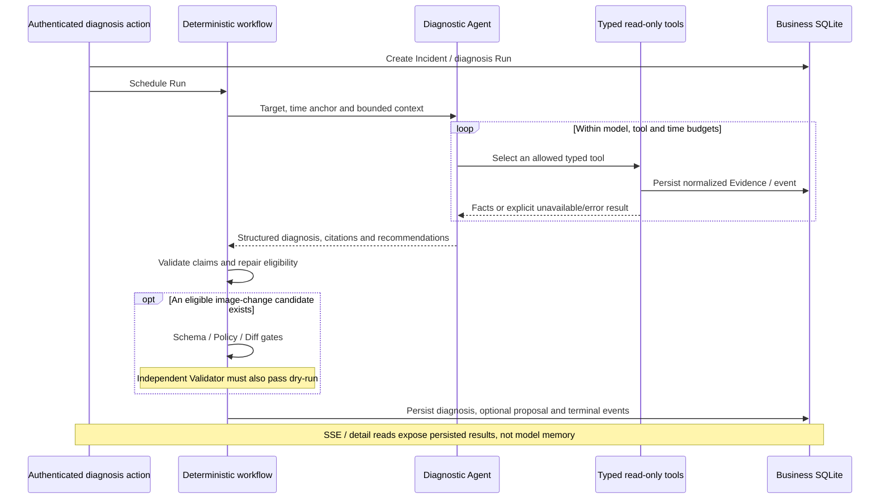
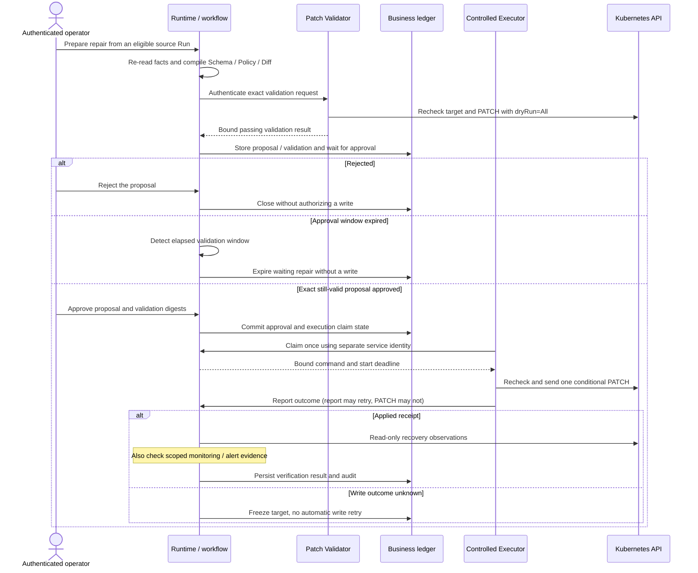

# Architecture

Components, trust boundaries and workflow contracts. See [evaluation and evidence](evaluation.md) for how to interpret validation results.

K8s Incident Agent handles runtime incidents, not general Kubernetes administration or pre-deployment YAML authoring. The product targets supported real Kubernetes environments; the installation profiles are scoped to fixed Kind and single-node K3s sandboxes.

## Components and trust boundaries

The [component diagram in the README](../README.md#architecture) shows the overall topology. The sections below explain its trust boundaries and detailed workflows.

Arrows show allowed communication, not shared authority. Dashed paths belong to the separately gated Executor; execution is disabled by default. The [Executor manifests](../deploy/application/executor/kustomization.yaml) are separate from the current application profiles; their presence is not an installed worker or permission to enable execution.

The browser holds neither kubeconfig nor service-to-service keys and cannot reach Kubernetes, Prometheus or SQLite directly. The BFF handles a fixed upstream, transport/error adaptation and SSE cancellation; it is not an authorization database or an arbitrary URL proxy. FastAPI owns authentication, business state and server-side safety gates.

Within Runtime, LangGraph controls deterministic state transitions. A single LangChain diagnostic Agent selects typed read-only tools inside that workflow. It does not choose whether an approval is valid, execute a patch, or decide to retry an ambiguous write. Kubernetes observations and bounded Prometheus results become persisted Evidence before they support diagnostic claims.

Source: [BFF client](../src/lib/agent-runtime/server-client.ts), [Runtime app](../services/agent-runtime/src/k8s_incident_agent/api.py), [workflow graph](../services/agent-runtime/src/k8s_incident_agent/workflow/graph.py), [supervisor](../services/agent-runtime/src/k8s_incident_agent/workflow/supervisor.py).

## Diagnosis: facts before explanations

The Alertmanager webhook durably records catalog-mapped occurrences independently of model availability. The occurrence key is `(fingerprint, startsAt)` with nanosecond precision. New firing notifications and previously unseen resolved notifications are stored without creating an Incident or Run. The monitoring overview exposes a bounded list and total of unassigned signals. Authenticated manual creation in development/evaluation profiles and diagnosis of existing Run-bearing Incidents use the diagnosis path above.

Repeated deliveries refresh the receipt time without duplicating an occurrence. Signal status describes the last notification, not verified current source state; historical resolved facts survive a later firing notification. For an already-associated signal, a changed notification appends an Incident-owned `alert.notification` event without changing Run state or business progress time. A resolved notification does **not** establish recovery, close the Incident or authorize a Kubernetes write.

A Runtime-owned reconciler reads unique Deployment, Service and PVC targets from the durable Incident and signal ledger. Its Kubernetes and Prometheus access is read-only. It has a 30-second cadence, at most eight targets and a 20-second pass budget. Committed notifications coalesce a wake-up when the loop is idle; restart and missed wake-ups recover from the ledger. After persisting a fresh observation, it transactionally checks occurrence association and bounded diagnosis admission. GET, SSR and SSE only read persisted projections; they never trigger reconciliation or model calls.

Each observation combines before/after SDK identity and health facts with source `ALERTS`, the catalog's native expression, matching rule definitions and bounded raw-input proofs at one Prometheus query time. This is cross-checked evidence, not a distributed atomic snapshot. Missing, stale, changed or unprovable inputs produce `UNKNOWN`; rule-level known activity remains visible when an unrelated rule is incomplete. The latest observation is stored once per target with a bounded last-known summary, not as a stream of polling Evidence. Incident lists and details require the recorded target UID or an unambiguous matching UID from historical Kubernetes Evidence; names alone do not attribute current activity. The home overview counts each target's rule activity once and separates it from last-notification totals. It shows activity for at most 20 targets, including targets without a received notification, without claiming a one-to-one notification association.

Association requires a real received occurrence, its own rule's complete fresh `FIRING` state and reliable target identity. On the same target UID, liveness restart, CrashLoop and Deployment replica unavailability share a catalog compatibility group; other alerts associate only with their own type. An exact OPEN target/group has one Incident. Ambiguous identity, a replaced object or a conflicting closed association is not silently reassigned, and undetermined historical lifecycle is not adopted by name. Source activity alone cannot invent an occurrence identity.

Relevant safe changes are coalesced durably by alert type while the Incident is busy, cooling down or diagnosis is unavailable. A repeated notification or elapsed time alone does not justify another Run. A successful diagnosis can cover an unchanged symptom only when its cited Evidence and fixed source actually cover the comparable facts. Failed or incomplete diagnoses are not treated as explanations. Automatic diagnosis is limited to three Runs per Incident, including the first, at least ten minutes apart. The Run count, active-Run/execution checks and creation share one SQLite transaction; failed or cancelled Runs consume their allowance, and manual reruns neither consume nor reset it. An Incident may exist without a Run; queued/triaging progress represents an actual Run, not deferred work.

Each diagnosis Run fixes its source, catalog revision, trigger reason, occurrence time and consumed change references at creation. Workflow policy, Prompt, tool time anchors, monitoring panels and evaluation consume that Run-specific context. Selecting a historical Run does not reinterpret it using the Incident's first alert or a newer symptom. Repair Runs retain their explicit source-Run chain. Safe comparison facts stay in the business ledger; public events expose references rather than the internal comparison snapshot.

Deployment health covers observed generation, replicas and owner-bound running/Ready regular containers. Service health covers supported selectors and ready EndpointSlices attributed to current candidate Pod UIDs, not end-to-end traffic. PVC health means the same claim is Bound, not that storage performance has been verified. These observations do not replace approval-bound repair recovery verification.

Lifecycle closure requires five continuous minutes of fresh, complete `CLEAR` observations for every catalog rule applicable to the target kind, plus positive health for the same verified target UID. A sample gap over 60 seconds, unknown or abnormal state, identity/rule change, inconsistent clock, new notification facts, a verification interruption or Runtime restart breaks continuity. The closing transaction rechecks the sampled observation, intake revision and persisted verification-interruption event cursor after acquiring the write lock, and refuses closure while a Run is active, approval is waiting or an execution still occupies that target. This is target-wide health confirmation, not independent closure based on only one alert group.

`incident.closed` records `observed_stable` for observational recovery without rewriting diagnostic status or Run results. `recovery_verified` additionally requires a real recovered repair verification for the same target in this OPEN period, with no subsequent health interruption. An applied receipt or `ROLLED_BACK` status alone is insufficient. Historical null lifecycle is undetermined and is not automatically closed or adopted by name.

An authenticated rerun or eligible rollback can atomically reopen a CLOSED Incident and create a new Run, preserving closure history and the automatic diagnosis count. Another OPEN Incident for the same target UID and compatible group causes `409 incident_reopen_conflict`; the histories are not merged. Ordinary apply preparation is not a reopen entry point: request a rerun first. Reopening does not relax approval, execution or ambiguous-write exclusions.

Source: [current reconciliation](../services/agent-runtime/src/k8s_incident_agent/application/reconciliation.py), [bounded Prometheus queries](../services/agent-runtime/src/k8s_incident_agent/monitoring/service.py).

Incident detail supports `selectedRun: null`, empty Run-owned data and inapplicable actions. Incident SSE includes both Incident-owned and Run-owned events on one cursor; Run history and Run-event pages contain only their selected Run. Persisted older Run events are projected to the current wire schema without rewriting their audit payloads.

`GET /api/v1/incidents` applies `alertId` (a catalog ID), `lifecycleStatus` (`OPEN`, `CLOSED`, `UNDETERMINED`), `alertState` (`FIRING`, `PENDING`, `CLEAR`, `UNKNOWN`) and business `status` filters before pagination. Pages default to 20 records, accept at most 100, and use creation time and ID for stable ordering. Cursors bind the selected conditions; changing a condition requires a fresh first page. The response includes the complete catalog filter options and each Incident's alert types, current summary and latest Run progress. Retained Scenario history uses the installed scenario-to-alert metadata independently of whether manual intake is enabled. Current-state filtering shares the detail projection's freshness and identity checks. A fixed read snapshot is processed in bounded blocks; a sparse filter can still scan the full matching history.

`selectedRun.diagnosisUsage` exposes the persisted diagnosis Run's model/tool call counts and its fixed model/tool/time limits. Repair Runs have null usage; unavailable historical counts stay null. It is a read projection for bounded evaluation and review, not a token or monetary billing record. An Incident's history can contain multiple Runs, each with its own trigger, Evidence and budget; SSE cursors belong to the complete Incident stream while event owners identify their actual Run or the Incident itself.

`GET /api/v1/incidents/{incident_id}/alerts` reads associated notification history without requiring a Run. It uses an Incident-bound cursor over `(startsAt, fingerprint)`, with the same page limits. Notification status, start/end facts and nullable receipt times remain separate from current observations and lifecycle closure. Detail `updatedAt` records business progress; retained historical values can include earlier notification refreshes and are not rewritten. `closure` contains the last persisted closure time and its `observed_stable` or `recovery_verified` basis, including after reopening. Reading these projections does not create work or change notification facts.

The diagnostic scope is broader than the executable action set: Pod/Deployment investigation can produce explanations, missing-information findings and manual recommendations without an executable proposal. Evidence of a terminated container with reason `OOMKilled` supports that termination fact. Without a memory trend, it does not establish where memory pressure came from; without the reason, a restart alone is not proof of OOM. CPU throttling alone is not proof that it caused slow startup.

The current default diagnosis budget is 12 model calls, 12 tool calls and 180 seconds, with deterministic final-output budgeting. The model baseline is `deepseek-flash`, non-thinking. Budget exhaustion and unavailable evidence remain explicit, not synthetic success. Locked configuration and tool policy—not scenario names—control the production path.

Monitoring uses the versioned [catalog](../monitoring/catalog/catalog.json) for alert routing, bounded queries and UI panels. `runId` selects a Run's source independently of the `current` or `occurrence` query-time anchor. Historical runs use their time anchor and resource identity rather than treating today's metrics as past evidence. Current K3s resource/probe collection and its shared-node limits are described in [security](security.md#monitoring-and-sensitive-data). Monitoring is not a general-purpose arbitrary-PromQL dashboard.

## Repair: preparation is not execution

Diagnosis and repair are different Run kinds. A repair Run records its source Run, revalidates current facts and prepares an exact candidate; the UI may show the referenced diagnosis without pretending a second diagnosis occurred. A recommendation is not executable just because it suggests an action. Current eligibility is limited to evidence-bound Deployment container-image replacement, including an explicitly prepared rollback to the recorded prior image.

The diagram shows the passing-validation path and selected execution outcomes, not every rejection branch or proof of a deployed execution loop. Failed validation cannot enter approval waiting. Rejection, staleness and expiry are distinct outcomes. Approval is valid only within the validation window (15 minutes from validation, not a fresh 15 minutes from the click); execution also has a short start deadline. Successful dry-run does not reserve a resource version. Successful PATCH does not prove recovery. A failed recovery does not trigger automatic rollback: rollback needs its own proposal, validation and approval.

Schema/Policy/Diff failures do not become a valid proposal. A persisted validation record describes what was checked, not a guarantee that cluster state still matches. `UNKNOWN` remains frozen for explicit investigation; refreshing a page, retrying a request or restarting Runtime must not resend the write.

Source: [repair preparation](../services/agent-runtime/src/k8s_incident_agent/repair/preparation.py), [Validator](../services/agent-runtime/src/k8s_incident_agent/repair/validator.py), [execution worker](../services/agent-runtime/src/k8s_incident_agent/execution/worker.py), [recovery verification](../services/agent-runtime/src/k8s_incident_agent/repair/verification.py).

## Persistence and deployment limits

The business ledger is authoritative for Incident, Run, Evidence, approvals and execution/recovery audit. A separate LangGraph checkpoint database stores resumable workflow progress, not a second authority for authorization. Run IDs connect them at the application layer; there is no cross-database foreign key. See the [schema and known discrepancy](data-model.md).

Retention is an explicit operator maintenance action, not an automatic TTL. It uses the last lifecycle closure time and protects OPEN/undetermined history, active or waiting work, ambiguous execution and unresolved signal facts. Eligible aggregates include CLOSED Incidents with no Runs and separately reconciled resolved-only unassigned occurrences. See [maintenance precautions](getting-started.md#8-explicit-retention-maintenance) before previewing or deleting data.

Current deployment is a single Runtime with SQLite, not a multi-tenant or horizontally scaled control plane. Kind supports development and CI; fixed K3s is the first installable demonstration target. Authentication and an isolated execution implementation do not establish production support, public HTTPS readiness or arbitrary-cluster compatibility. See [selected decisions](decisions/README.md) for why these boundaries exist.
